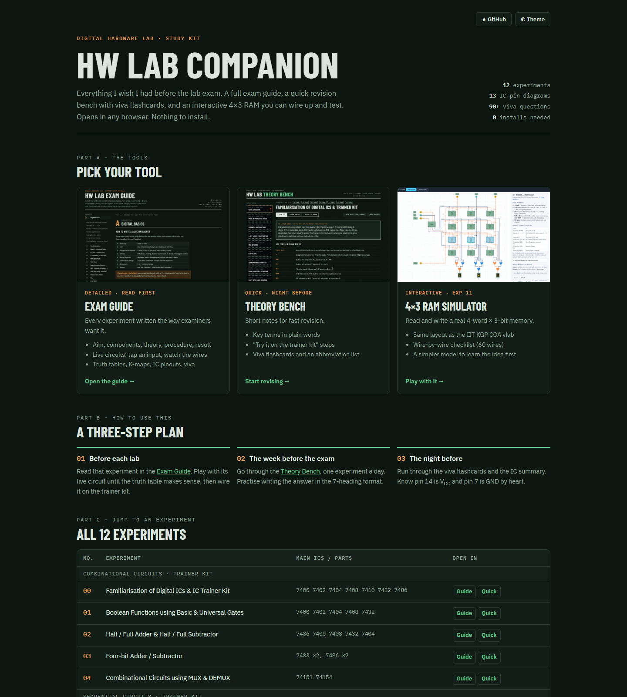
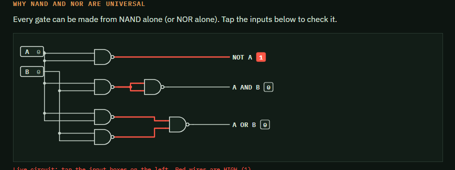
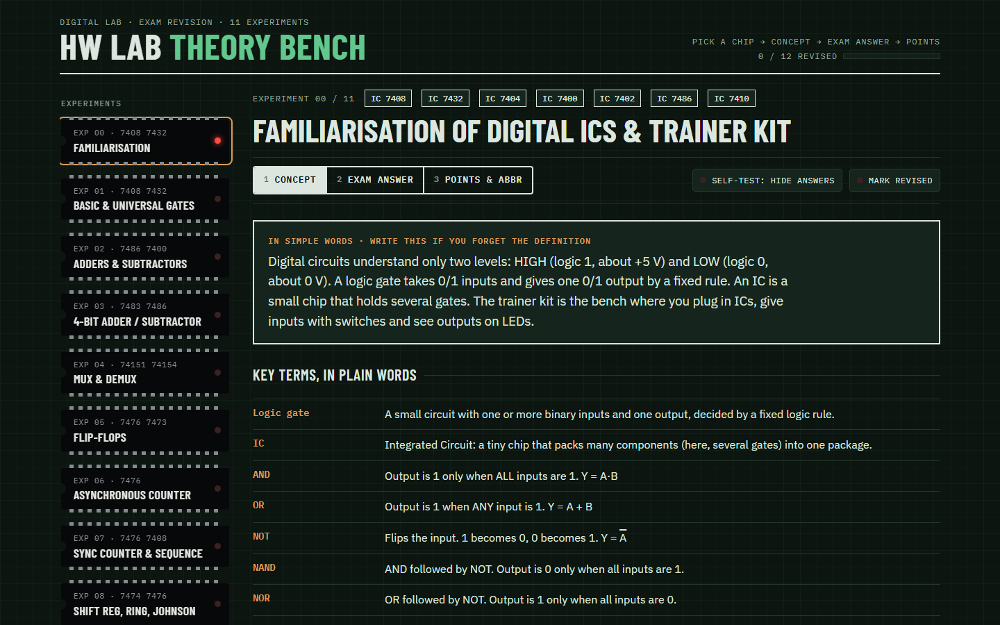
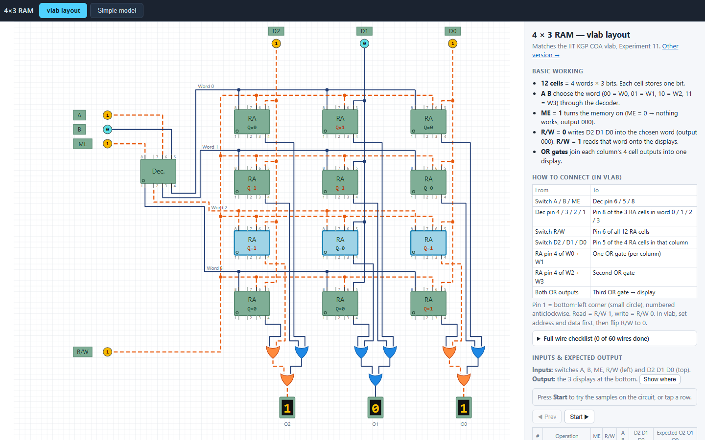
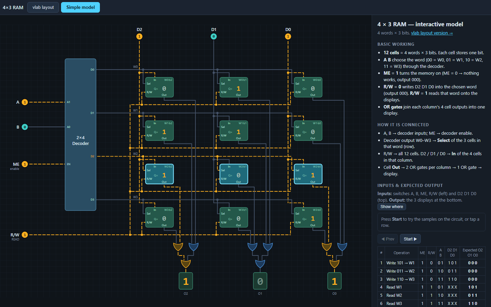
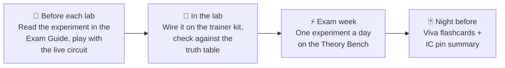

<div align="center">

# ⚡ HW Lab Companion

**A free, open study kit for the Digital Hardware Lab.**
Exam guide · viva flashcards · interactive 4×3 RAM simulator. All 12 experiments. Runs in any browser.

[](https://fitcoder-shoaib.github.io/hw-lab-companion/)
[](#-experiments-covered)
[](#-how-to-use-it)
[](LICENSE)



</div>

---

## 👋 Why this exists

The lab manual tells you *what* to wire. It rarely tells you *why*, and it never shows you a circuit moving.
I made these tools while preparing for my own lab exam, and I'm leaving them here so the next batch has an easier time.

- **No setup.** Each tool is a single HTML file. Open it in Chrome, Edge, Firefox or Safari. Works on your phone too.
- **Works offline.** Download the repo once and you're set, even in a lab with no Wi-Fi.
- **Written for exams.** Every experiment follows the 7-heading answer format examiners look for.

## 🧰 What's inside

| Tool | Best for | What you get |
|---|---|---|
| 📘 **[Exam Guide](https://fitcoder-shoaib.github.io/hw-lab-companion/guides/exam-guide.html)** *(detailed)* | Before each lab, and deep study | Aim, components, theory, **live circuit diagrams** (tap an input, watch the signal), truth tables, K-maps, procedure, result and viva for every experiment. Plus digital basics, 13 IC pin diagrams, a searchable abbreviation list and all 60 viva questions in one place. |
| ⚡ **[Theory Bench](https://fitcoder-shoaib.github.io/hw-lab-companion/guides/theory-bench.html)** *(quick)* | Last-week revision | Key terms in plain words, "try it on the trainer kit" steps, points to remember, viva flashcards and abbreviations. |
| 🧠 **[4×3 RAM Simulator](https://fitcoder-shoaib.github.io/hw-lab-companion/simulators/ram-4x3.html)** | Experiment 11 | A clickable 4-word × 3-bit RAM. Two views: one that matches the **IIT KGP COA virtual lab** layout pin-for-pin (with a 60-wire checklist), and a simpler model to learn the idea first. |

<table>
<tr>
<td width="50%"><br><sub><b>Exam Guide</b>: live circuits. Tap an input and the HIGH wires turn red</sub></td>
<td width="50%"><br><sub><b>Theory Bench</b>: quick notes and flashcards</sub></td>
</tr>
<tr>
<td width="50%"><br><sub><b>RAM Simulator</b>: vlab layout with pin-level wiring</sub></td>
<td width="50%"><br><sub><b>RAM Simulator</b>: simple model for understanding read/write</sub></td>
</tr>
</table>

## 🚀 How to use it

**Option 1: online (easiest).** Open **https://fitcoder-shoaib.github.io/hw-lab-companion/** and pick a tool.

**Option 2: offline.** Click the green **Code** button → **Download ZIP**, unzip it, and double-click `index.html`.

**Option 3: clone it.**

```bash
git clone https://github.com/fitcoder-shoaib/hw-lab-companion.git
```

> [!TIP]
> Both guides support direct links to an experiment. Add `#exp05` to the end of the URL to jump straight to Flip-Flops, `#exp11` for RAM, and so on.

### Suggested study plan



## 🔬 Experiments covered

| No. | Experiment | Main ICs / parts | Jump in |
|:-:|---|---|---|
| | **Combinational circuits** · *trainer kit* | | |
| 00 | Familiarisation of Digital ICs & IC Trainer Kit | 7400, 7402, 7404, 7408, 7410, 7432, 7486 | [Guide](https://fitcoder-shoaib.github.io/hw-lab-companion/guides/exam-guide.html#exp00) · [Quick](https://fitcoder-shoaib.github.io/hw-lab-companion/guides/theory-bench.html#exp00) |
| 01 | Boolean Functions using Basic & Universal Gates | 7400, 7402, 7404, 7408, 7432 | [Guide](https://fitcoder-shoaib.github.io/hw-lab-companion/guides/exam-guide.html#exp01) · [Quick](https://fitcoder-shoaib.github.io/hw-lab-companion/guides/theory-bench.html#exp01) |
| 02 | Half / Full Adder & Half / Full Subtractor | 7486, 7400, 7408, 7432, 7404 | [Guide](https://fitcoder-shoaib.github.io/hw-lab-companion/guides/exam-guide.html#exp02) · [Quick](https://fitcoder-shoaib.github.io/hw-lab-companion/guides/theory-bench.html#exp02) |
| 03 | Four-bit Adder / Subtractor | 7483 ×2, 7486 ×2 | [Guide](https://fitcoder-shoaib.github.io/hw-lab-companion/guides/exam-guide.html#exp03) · [Quick](https://fitcoder-shoaib.github.io/hw-lab-companion/guides/theory-bench.html#exp03) |
| 04 | Combinational Circuits using MUX & DEMUX | 74151, 74154 | [Guide](https://fitcoder-shoaib.github.io/hw-lab-companion/guides/exam-guide.html#exp04) · [Quick](https://fitcoder-shoaib.github.io/hw-lab-companion/guides/theory-bench.html#exp04) |
| | **Sequential circuits** · *trainer kit* | | |
| 05 | Flip-Flops (SR, JK, D, T, Master-Slave) | 7400, 7410, 7404, 7476, 7473, 7474 | [Guide](https://fitcoder-shoaib.github.io/hw-lab-companion/guides/exam-guide.html#exp05) · [Quick](https://fitcoder-shoaib.github.io/hw-lab-companion/guides/theory-bench.html#exp05) |
| 06 | Asynchronous (Ripple) 4-bit Up & Down Counter | 7476 ×2 | [Guide](https://fitcoder-shoaib.github.io/hw-lab-companion/guides/exam-guide.html#exp06) · [Quick](https://fitcoder-shoaib.github.io/hw-lab-companion/guides/theory-bench.html#exp06) |
| 07 | Synchronous Counter & Sequence Generator | 7476 ×2, 7408 | [Guide](https://fitcoder-shoaib.github.io/hw-lab-companion/guides/exam-guide.html#exp07) · [Quick](https://fitcoder-shoaib.github.io/hw-lab-companion/guides/theory-bench.html#exp07) |
| 08 | Shift Registers, Ring & Johnson Counter | 7474 ×2, 7476 ×2 | [Guide](https://fitcoder-shoaib.github.io/hw-lab-companion/guides/exam-guide.html#exp08) · [Quick](https://fitcoder-shoaib.github.io/hw-lab-companion/guides/theory-bench.html#exp08) |
| | **Computer organisation** · *virtual lab* | | |
| 09 | Design of Ripple Carry Adder | 1 half adder, 3 full adders | [Guide](https://fitcoder-shoaib.github.io/hw-lab-companion/guides/exam-guide.html#exp09) · [Quick](https://fitcoder-shoaib.github.io/hw-lab-companion/guides/theory-bench.html#exp09) |
| 10 | Design of a 4-bit ALU (AND, OR, XOR, ADD) | four 1-bit ALU blocks | [Guide](https://fitcoder-shoaib.github.io/hw-lab-companion/guides/exam-guide.html#exp10) · [Quick](https://fitcoder-shoaib.github.io/hw-lab-companion/guides/theory-bench.html#exp10) |
| 11 | Design of 4×3 RAM Memory | 12 RAM cells, decoder, 9 OR gates | [Guide](https://fitcoder-shoaib.github.io/hw-lab-companion/guides/exam-guide.html#exp11) · [Quick](https://fitcoder-shoaib.github.io/hw-lab-companion/guides/theory-bench.html#exp11) · [**Simulator**](https://fitcoder-shoaib.github.io/hw-lab-companion/simulators/ram-4x3.html) |

📌 Need IC pinouts at a glance? See the **[IC quick reference](docs/ic-reference.md)**.

## 🎯 Scope

**This repo covers**
- The 12 experiments of a typical first/second-year **Digital Electronics / Hardware Lab** (TTL 74-series ICs on a trainer kit, plus three COA virtual-lab experiments).
- Theory, circuit design, truth tables, procedure and viva prep for each one.
- Interactive aids where a picture moving helps more than text.

**This repo does not**
- Replace your official lab manual or record book. Those come from your department.
- Include lab manual PDFs, record answers to copy, or exam papers.
- Cover analog electronics, microprocessors or HDL (Verilog/VHDL). Those may come later. See the [roadmap](#-roadmap).

> [!IMPORTANT]
> This is a student-made study aid. Pin numbers and circuits follow standard TTL datasheets, but **your lab manual and your faculty always have the final word**. If something here disagrees with your manual, trust the manual and [tell us](https://github.com/fitcoder-shoaib/hw-lab-companion/issues/new/choose).

## 🗂️ Repository layout

```text
hw-lab-companion/
├── index.html                 ← home page (GitHub Pages entry)
├── guides/
│   ├── exam-guide.html        ← detailed guide, all 12 experiments
│   └── theory-bench.html      ← quick revision + viva flashcards
├── simulators/
│   └── ram-4x3.html           ← interactive 4×3 RAM (vlab + simple views)
├── docs/
│   ├── ic-reference.md        ← IC pinout cheat sheet
│   └── images/                ← screenshots
└── .github/                   ← issue templates, PR template, link checker
```

Every tool is **one self-contained HTML file**: HTML, CSS and JavaScript together, no build step, no frameworks. The only network request is Google Fonts, and the pages fall back to system fonts when offline.

## 🗺️ Roadmap

- [x] Exam guide for all 12 experiments
- [x] Quick revision bench with viva flashcards
- [x] Interactive 4×3 RAM (vlab layout + simple model)
- [ ] Interactive ripple carry adder and ALU (Exp 09, 10)
- [ ] Counter / shift register animations (Exp 06 to 08)
- [ ] Printable one-page cheat sheet (PDF)
- [ ] Self-test quiz mode

Want to build one of these? See below.

## 🤝 Contributing

Juniors, this is yours now too. Found a wrong pin number, a typo, or a viva question that came up in your exam? Please add it.

- 🐞 **Spotted a mistake?** [Open a "content error" issue](https://github.com/fitcoder-shoaib/hw-lab-companion/issues/new/choose). Takes one minute.
- 💡 **Have an idea?** [Suggest a feature](https://github.com/fitcoder-shoaib/hw-lab-companion/issues/new/choose).
- 🛠️ **Want to fix it yourself?** Read [CONTRIBUTING.md](CONTRIBUTING.md). Editing is just opening an HTML file in a text editor.

If this helped you, **leave a ⭐**. It helps the next batch find it.

## 📄 License

[MIT](LICENSE). Use it, share it, fork it for your own college's lab.

<div align="center"><sub>Made by a senior, for juniors. Good luck in the lab. 🔌</sub></div>
